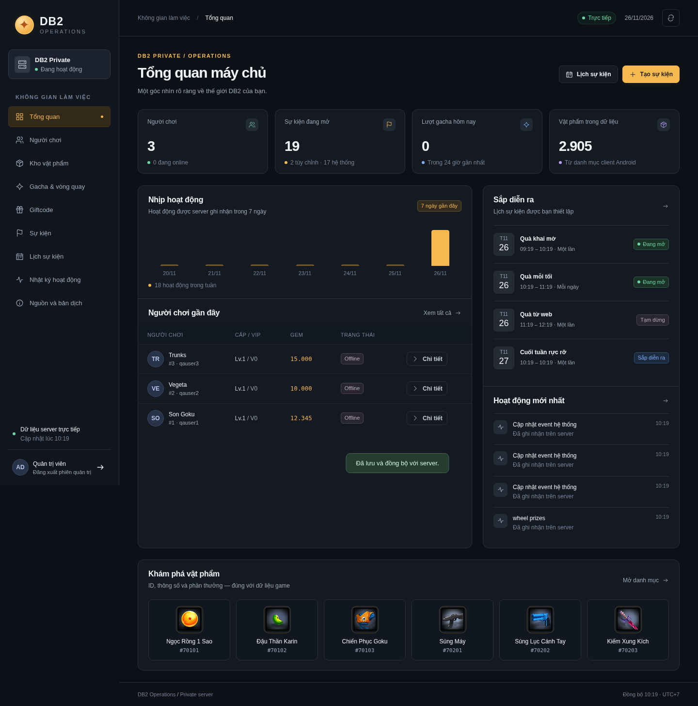
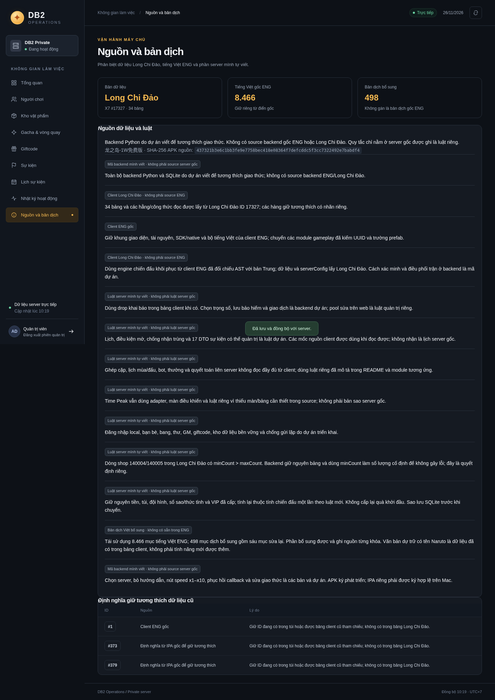

# DB2 Operations

Web quản trị mới chạy **trong cùng tiến trình Python và cùng SQLite với game**. Có 9 khu vực: tổng quan, người chơi, kho vật phẩm, gacha/vòng quay, giftcode, sự kiện, lịch, nhật ký, nguồn và bản dịch. UI dùng hướng dẫn [UI UX Pro Max](https://github.com/nextlevelbuilder/ui-ux-pro-max-skill/blob/main/.claude/skills/ui-ux-pro-max/SKILL.md); token thiết kế và ghi chú về bố cục nằm ở `web/design-system.json`.

## Chạy và cập nhật

Dùng source nhánh `route-342`, giữ nguyên thư mục `data/` của server hiện có rồi khởi động lại `start.bat` hoặc `python start.py`. Không chép đè database của mình bằng database thử nghiệm.

Trên chính máy chạy server, mở `http://127.0.0.1:20003/` hoặc `/admin`. Token vẫn là file `data/admin-token` của server. Web không cần npm/build step hoặc tải font/CDN ngoài. Node.js vẫn cần cho engine chiến đấu của game.

Trong máy ảo cuộc chat, server dùng `/workspace/db2-live` ở cổng `20003`; dữ liệu cũ đã được sao lưu trong thư mục `backups/` trước khi cập nhật. Địa chỉ `localhost` của máy ảo không phải địa chỉ truy cập từ máy cá nhân. Cấu hình Cloud hiện chưa có HTTP preview cho cổng này; để mở web từ Codex Cloud, vào **Edit Environment → HTTP Previews**, thêm **20003** và chọn **Apply to this chat** khi có tùy chọn đó. Dùng URL được môi trường cung cấp sau khi áp dụng. Không có URL public tự tạo trong bản cập nhật này.

## Nguồn Long Chi Đảo và bản dịch

Bản hiện tại dùng dữ liệu Long Chi Đảo X7 #17327 và tiếng Việt ENG làm nền. Mục **Nguồn và bản dịch** phân biệt dữ liệu client Trung, định nghĩa giữ tương thích ENG/iOS, mã backend tự viết và luật riêng. Chi tiết mỗi item có nguồn tên/mô tả Việt; các mục mới không được gán là bản dịch gốc ENG. 8.466 mục Việt ENG + 498 mục bổ sung tạo 8.958 khóa (sáu mục được sửa).

Khi mở database cũ lần đầu bằng bản này, server sao lưu SQLite vào `backups/before-longzhidao-*.sqlite3` trước khi chuyển. Schema 29 giữ tiền, túi, đội hình và VIP đã cấp; tính lại thuộc tính chiến đấu theo luật mới. Giữ cả source/data cũ để có thể quay lại cùng một phiên bản.

## Chức năng

| Mục | Thao tác thực sự được server hỗ trợ |
| --- | --- |
| Tổng quan | Người chơi/online, event mở, gacha 24 giờ, hoạt động 7 ngày, người chơi gần đây, lỗi client |
| Kho vật phẩm | 2.905 định nghĩa; tìm tên/ID không cần gõ đúng dấu tiếng Việt; lọc loại/phẩm màu; ảnh, stack, giá gốc và toàn bộ thông số |
| Người chơi | Hồ sơ, đội hình, từng ô túi và thuộc tính instance; đặt gem/coin/thể lực/điểm kỹ năng; cấp vật phẩm/tướng; cấp/thu hồi GM; thư hệ thống một người hoặc toàn server |
| Gacha | 4 pool, chỉnh ID/số lượng/sao/trọng số, tỉ lệ tính từ tổng trọng số, xóa dòng và phục hồi bảng gốc |
| Vòng quay | Bảng 8 ô và trọng số dùng bởi năm vòng quay và hai chế độ quay điểm |
| Giftcode | Gem và vật phẩm kèm theo; sửa hạn/lượt; tạm dừng; thống kê lượt đã dùng; mỗi nhân vật một lần |
| Event tùy chỉnh | Bật/tắt, lịch bắt đầu/kết thúc, cấp tối thiểu, phần thưởng hỗn hợp, một lần/hằng ngày/hằng tuần, giới hạn ngày dừng |
| Event hệ thống | 17 mục bên dưới, bật/tắt/lịch/mô tả và các trường chuyên biệt tương ứng |
| Lịch | Các kỳ của event tùy chỉnh và lịch riêng của event hệ thống; lịch tháng desktop, danh sách ngày trên mobile; UTC+7 |
| Nhật ký | Phân trang, lọc hoạt động, xem dữ liệu chi tiết và stack lỗi client |

Cấp kinh nghiệm/VIP bằng phần thưởng ID **100/98**, để server tính cấp theo bảng gốc. UI không gán trực tiếp những chỉ số được engine tính. Tướng trùng chuyển thành mảnh theo luật game; UI không tạo một bản sao tướng trái với mô hình client.

## 17 event hệ thống có thể chỉnh

| ID | Phần có thể chỉnh ngoài bật/tắt, lịch và mô tả |
| --- | --- |
| `saveGemUpgradeLevel` | Phần thưởng các mốc gửi gem/lên cấp |
| `saveGemUpgradeLevelFree` | Quà gửi gem hằng ngày |
| `task_active` | 5 phần thưởng điểm năng động |
| `privateLogin` | 14 phần thưởng đăng nhập và nhánh mở rộng |
| `upgradeVip` | 16 mốc quà cấp VIP |
| `privateSelect` | Đúng 3 lựa chọn quà, đồng bộ cả danh sách client và thưởng thực nhận |
| `endless_reward` | 2 nhóm quà định kỳ; điều kiện mua gói/cooldown vẫn kiểm tra ở server |
| `dreamRollQuest` | Các mốc nhiệm vụ xúc xắc |
| `privateSpWish` | Giá gem/lượt, giới hạn lượt bằng gem/ngày, ngưỡng bảo hiểm SP |
| `scorePoint1`, `scorePointStarSign` | 5 mốc điểm tăng dần và 5 rương tương ứng |
| `dream` | 4 nhóm thưởng ô thường và quà qua một vòng; hiệu ứng các ô đặc biệt giữ nguyên |
| `dial:luck`, `dial:vip`, `dial:svip`, `dial:shen`, `dial:pay` | Đóng/mở/lịch của từng vòng; bảng thưởng chung chỉnh ở Gacha & vòng quay |

Các điều kiện hoàn thành mặc định không phải một trình chạy luật tùy ý. Chức năng ngoài danh sách này, như lịch giải đấu/bang chiến và hiệu ứng skill, vẫn theo module nghiệp vụ hiện có; không có nút trên web giả vờ sửa các phần chưa nối vào server. Nút vòng quay của client cũ có thể vẫn hiện khi đóng, nhưng RPC không cho chi tiêu/quay ngoài lịch.

Sự kiện tùy chỉnh dùng DTO `activity.map` mà màn Event hiện có đọc được. Tên kỹ thuật/ID là khóa ổn định gửi trong RPC; tên và mô tả quản trị không đổi ID của event đã phát hành.

## Đồng bộ và dữ liệu bền vững

- Cấu hình nằm trong `ops_records`; sự kiện/giftcode/pool vẫn dùng các bảng nghiệp vụ thật. Không lưu cấu hình game chỉ trong trình duyệt.
- Thay đổi liên quan nhân vật/event gửi qua push `onSync` cho phiên game đã vào nhân vật; nhân vật offline nạp cấu hình mới lúc đọc hồ sơ/đăng nhập. Lịch được kiểm tra lại mỗi RPC; cập nhật trạng thái lên client online trong khoảng 10 giây.
- Web đọc lại sau khi lưu và làm mới khoảng 20 giây khi không nhập liệu/mở form. Token chỉ ở bộ nhớ hoặc session của tab nếu người dùng chọn giữ kết nối.
- Giftcode và nhận thưởng/thư đều cập nhật cùng transaction với receipt. Thử lại không tạo thêm quà. Lưu trữ event không xóa lịch sử hoặc cho dùng lại ID.
- Kỳ lặp nhận thưởng theo ngày/tuần UTC+7; đổi giờ trong cùng kỳ không cấp lại lượt. Không đổi loại chu kỳ sau khi đã có lượt nhận: cần tạo ID mới.
- Form event/cấu hình có kiểm tra phiên bản; đặt tài nguyên nhân vật có đối chiếu giá trị cũ. Khi cửa sổ khác đã sửa, server trả lỗi để làm mới, không âm thầm ghi đè.
- Pool gacha tùy chỉnh chọn một mục theo trọng số và thay thế nhánh drop/bảo hiểm mặc định của pool đó. Khôi phục bảng gốc dùng lại luật gốc đã triển khai. Tỉ lệ nhỏ vẫn hiển thị chữ số có nghĩa.

## Ảnh và kiểm tra

Ảnh lấy từ **archive Android đã được chủ dự án cung cấp/cho phép sử dụng**. Không lấy payload IPA riêng. Decoder `Image::initWithImageData` trong ARM64 cho thấy AES-128-CBC ở prefix ảnh; công cụ tái lập kiểm SHA native trước khi đọc key/IV từ binary và kiểm CRC mọi chunk PNG sau giải mã. Có 1.084 PNG riêng ánh xạ đủ 2.905 item/role.

Ảnh đã đi kèm source để máy chạy server không cần thư viện crypto. Chỉ khi tái lập asset mới cần `cryptography`:

```sh
python -m pip install cryptography
python -m tools.extract_admin_icons ORIGINAL_ANDROID_ARCHIVE.zip
```

Kiểm thử backend và client generator (bộ 260 ca, xem kết quả bản phát hành trong analysis/longzhidao-validation.json):

```sh
python -m unittest discover -s tests
```

Kiểm thử trình duyệt tái lập với database tạm riêng (cần Node + Playwright/Chromium):

```sh
python -m tools.check_admin_browser
```

Công cụ tự tạo dữ liệu QA trong thư mục tạm, mở cổng loopback ngẫu nhiên, chạy 22 luồng thực và đóng/xóa database tạm sau khi xong. Không kết nối database đang chạy. Ảnh nằm ở `artifacts/admin-browser/`.

Bằng chứng: `analysis/longzhidao-validation.json`, `analysis/admin-browser-tests.json`, `analysis/admin-icons.json`. Browser QA dùng database thử nghiệm riêng; không seed demo vào database đang chạy của người dùng. Các kiểm tra này không thay thế kiểm thử native Android/iPhone.




